<br><br>

<p align='center' >
  
</p>
<br><br>

<p align="center">
  <a href="https://vuejs.org/">
    
  </a>
  <a href="https://vuetifyjs.com/">
    
  </a>
    <a href="https://vitejs.dev/">
    
  </a>
  
  <a href="https://github.com/yangjiakai/lux-ui/blob/main/LICENSE">
    
  </a>
</p>

<h4 align='center'>
<a href="https://lux.vuetify3.com/">ライブ・デモ</a>
</h4>

<br>

<p align='center'>
<a href="./README.md">English</a> | <a href="./README.zh-CN.md">简体中文</a> | <b>日本語</b>
</p>

> **メンテナンスモード**：Vue / Vuetify の新しいバージョンへの追従は続けます（現在 **Vuetify 4** に対応）が、新機能の追加は予定していません。Issue や PR は引き続き歓迎します。

## 📖 序文

> 目標は、最も優れた Vuetify の Admin オープンソーステンプレートを作成することです。

Vuetify の洗練されたテーマを基盤に、明確で効率的なプロジェクト構造を構築し、最新の技術フレームワークを統合しています。このプロジェクトは、さまざまな一般的な技術要件や機能に対応することを目指し、AI アシスタントを組み込むことで、よりインテリジェントな体験を提供します。さらに、すべてのページが複数のデバイスで適応的に表示されるようにし、シームレスなクロスプラットフォーム互換性を実現しています。

## 📖Other Versions

SPA Full Version: [lux-ui](https://github.com/yangjiakai/lux-nuxt3)

SPA Simplified i18n Version[lux-ui-i18n](https://github.com/yangjiakai/vuetify3-lux-admin-template-i18n)

SPA Simplified chinese Version[lux-ui-zh](https://github.com/yangjiakai/vuetify3-lux-admin-template-zh)

Nuxt3 version:

Nuxt3 Full Version [lux-nuxt3](https://github.com/yangjiakai/lux-nuxt3)

Nuxt3 Simplified Version [lux-nuxt3-template](https://github.com/yangjiakai/lux-nuxt3-template)

## 📖Documents

- 📖 [Document 1.0 Chinese](https://www.craft.me/s/tAMVv4hUxZIH6G)

## 📚 特徴

- 📖 [Vue 3.5](https://github.com/vuejs/core)
- 📖 [Vite 8](https://github.com/vitejs/vite)
- 📖 UI Framework [Vuetify 4](https://vuetifyjs.com/)
- 📖 TypeScript
- 📦 Component Auto Importing
- 🍍 [Pinia](https://pinia.vuejs.org/)
- 📔 `<script setup>`
- 📚 Use icons from any icon sets in [Iconify](https://icon-sets.iconify.design/)
- ☁️ Deploy on Netlify, zero-config
- 📈 Echarts, ApexChart
- 🧭 Openai, Chatgpt
- 🌍 vue-i18n
- 📚 virtual-scroller , vuedraggable , perfect-scrollbar
- 📝 Rich Text Editor
- 📇 Responsive multi-platform adaptive

## 📈 Project Activity


## 💬 連絡

- Email <a href="mailto:yjkbako@gmail.com">yjkbako@gmail.com</a>
- Twitter https://twitter.com/baibaixiang
- Wechat 

## 💌 プレビュー

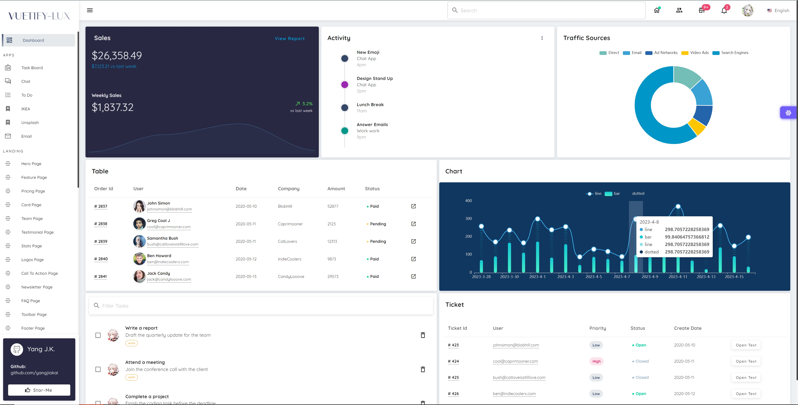
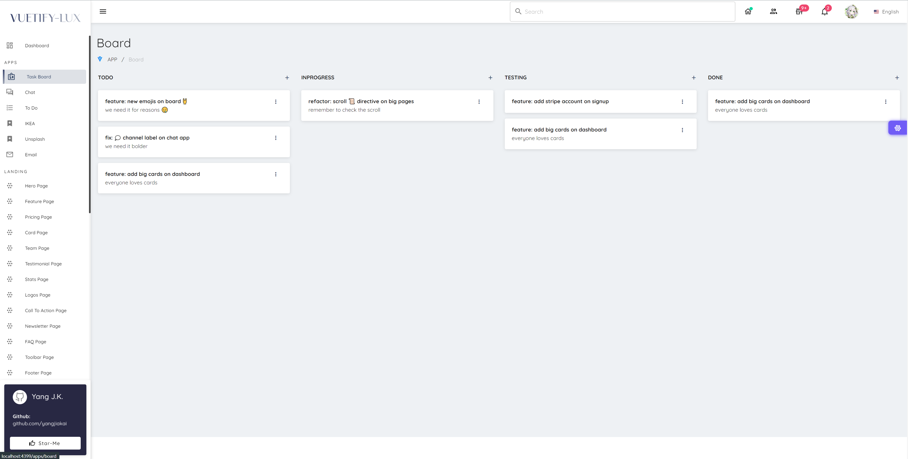
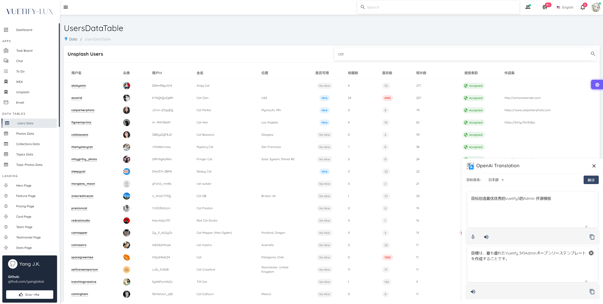
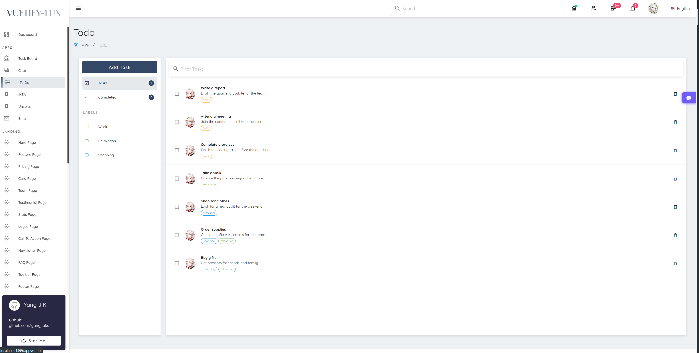
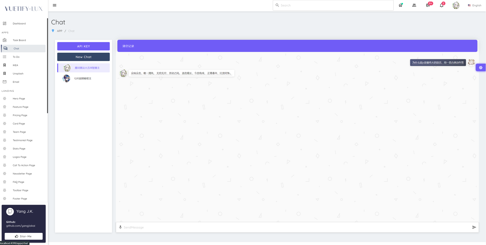
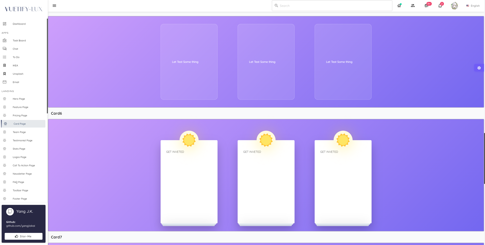
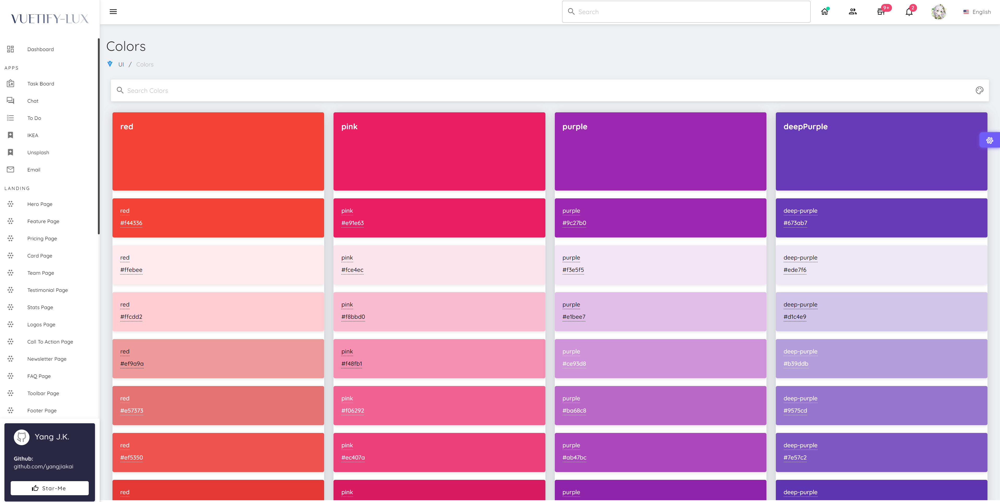
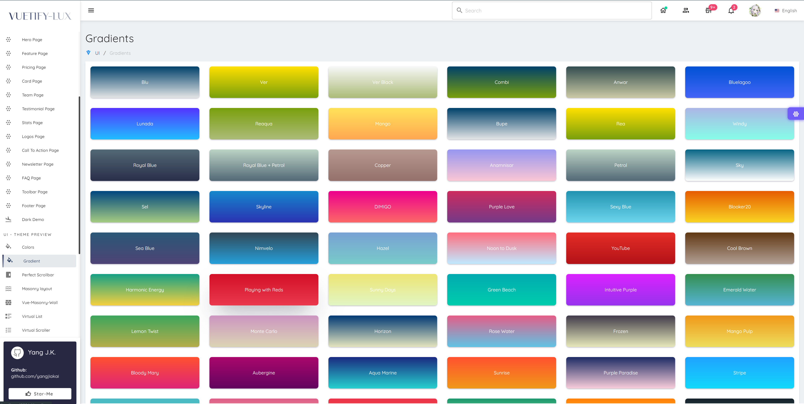
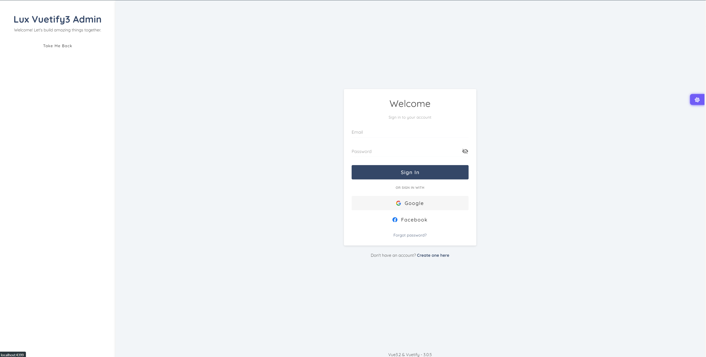
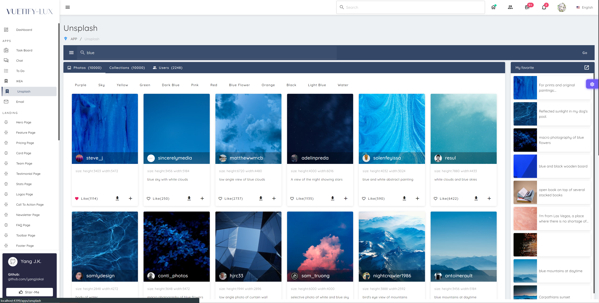
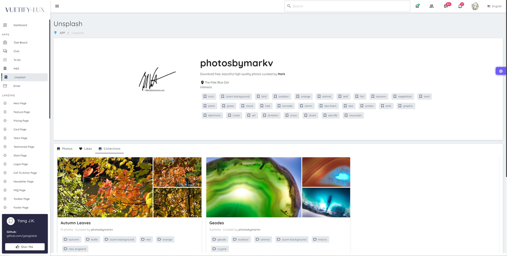

<br>

## 📦 プリパック

### 🏷️UI Frameworks

- [Vuetify3](https://vuetifyjs.com/) - Vuetify は、美しく手作りされた Vue コンポーネントで構成された、デザインスキル不要の UI フレームワークです。

### 🏷️Icons

- [Iconify](https://iconify.design) - 任意のアイコンセットを使用 [🔍Icônes](https://icones.netlify.app/)

### 🏷️ プラグイン

- [Vue Router 5](https://router.vuejs.org/)
- [VueUse](https://github.com/antfu/vueuse) - 便利なコンポジション API 集
- [VuedDaggable](https://github.com/SortableJS/Vue.Draggable) - 配列モデルと同期したドラッグ＆ドロップによる配置操作が可能
- [Vue-Masonry-Wall](https://github.com/DerYeger/yeger/tree/main/packages/vue-masonry-wall) -Vue 3 のレスポンシブな Masonry レイアウト SSR をサポートしています
- [Vue-Virtual-Scroller](https://github.com/Akryum/vue-virtual-scroller) - 超高速の任意のデータ量のスクロール

## 👻 今すぐ試す!

> Node.js 20.19 以上が必要です（24 推奨）。

```
git clone https://github.com/yangjiakai/lux-ui.git

cd lux-ui

yarn install

yarn dev
```

## 👻Docker it!

1. 开发环境构建镜像：

   ```
   docker-compose build dev
   ```

2. 启动开发环境：

   ```
   docker-compose up dev
   ```

3. 生产环境构建镜像：

   ```
   docker-compose build app
   ```

4. 启动生产环境：
   ```
   docker-compose up app
   ```

### 🔑 API キーの設定

ルートの `.env.template` を `.env` にコピーし、`VITE_UNSPLASH_ACCESS_KEY`、`VITE_GITHUB_CLIENT_ID`、`VITE_TTS_KEY`、`VITE_TTS_REGION` をご自身のキーに置き換えてください。`VITE_GA_ID`（Google Analytics）は任意です。

OpenAI の API キーはアプリ内で入力し、ブラウザに保存されます。

> `VITE_*` の値はすべてビルド後の JavaScript に含まれるため、公開しても問題ないキーだけを設定してください。

> openai apikey： https://platform.openai.com/account/api-keys

> unsplash apikey： https://unsplash.com/oauth/applications

> github apikey： https://github.com/settings/tokens

> azure textToSpeech : https://speech.microsoft.com/
