<br><br>

<p align='center' >
  
</p>
<br><br>

<p align="center">
  <a href="https://vuejs.org/">
    
  </a>
  <a href="https://vuetifyjs.com/">
    
  </a>
    <a href="https://vitejs.dev/">
    
  </a>
  
  <a href="https://github.com/yangjiakai/lux-ui/blob/main/LICENSE">
    
  </a>
</p>

<h4 align='center'>
<a href="https://lux.vuetify3.com/">Live Demo</a>
</h4>

<br>

<p align='center'>
<b>English</b> | <a href="./README.zh-CN.md">简体中文</a> | <a href="./README.jp.md">日本語</a>
</p>

> **Maintenance mode** — Lux UI keeps up with new Vue / Vuetify releases (now on **Vuetify 4**), but no new features are planned. Issues and pull requests are still welcome.

## 📖Introduction

> Goal: Creating the best Vuetify Admin open-source template.

Built upon the elegant themes of Vuetify, we have established a clear and efficient project structure, integrating the latest technology frameworks. This project aims to address a wide range of common technical requirements and features, while incorporating an AI assistant for a more intelligent experience. Additionally, we ensure that all pages are adaptive across multiple devices, achieving a seamless cross-platform compatibility.

## 📖Other Versions

SPA Full Version: [lux-vuetify3](https://github.com/yangjiakai/lux-nuxt3)

SPA Simplified i18n Version[lux-vuetify3-i18n](https://github.com/yangjiakai/vuetify3-lux-admin-template-i18n)

SPA Simplified chinese Version[lux-vuetify3-zh](https://github.com/yangjiakai/vuetify3-lux-admin-template-zh)

Nuxt3 version:

Nuxt3 Full Version [lux-nuxt3](https://github.com/yangjiakai/lux-nuxt3)

Nuxt3 Simplified Version [lux-nuxt3-template](https://github.com/yangjiakai/lux-nuxt3-template)

## 📖Documents

- 📖 [Document 1.0 Chinese](https://www.craft.me/s/tAMVv4hUxZIH6G)

## 📚Features

- 📖 [Vue 3.5](https://github.com/vuejs/core)
- 📖 [Vite 8](https://github.com/vitejs/vite)
- 📖 UI Framework [Vuetify 4](https://vuetifyjs.com/)
- 📖 TypeScript
- 📦 Component Auto Importing
- 🍍 [Pinia](https://pinia.vuejs.org/)
- 📔 `<script setup>`
- 📚 Use icons from any icon sets in [Iconify](https://icon-sets.iconify.design/)
- ☁️ Deploy on Netlify, zero-config
- 📈 Echarts, ApexChart
- 🧭 Openai, Chatgpt
- 🌍 vue-i18n
- 📚 virtual-scroller , vuedraggable , perfect-scrollbar
- 📝 Rich Text Editor
- 📇 Responsive multi-platform adaptive

## 📈 Project Activity


## 💬Contact Me

- Email <a href="mailto:yjkbako@gmail.com">yjkbako@gmail.com</a>
- Twitter https://twitter.com/baibaixiang
- Wechat 

## 💌Preview

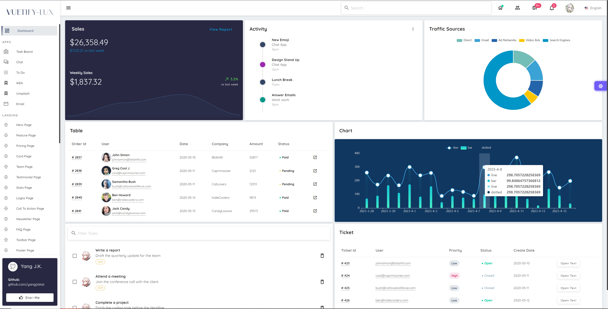
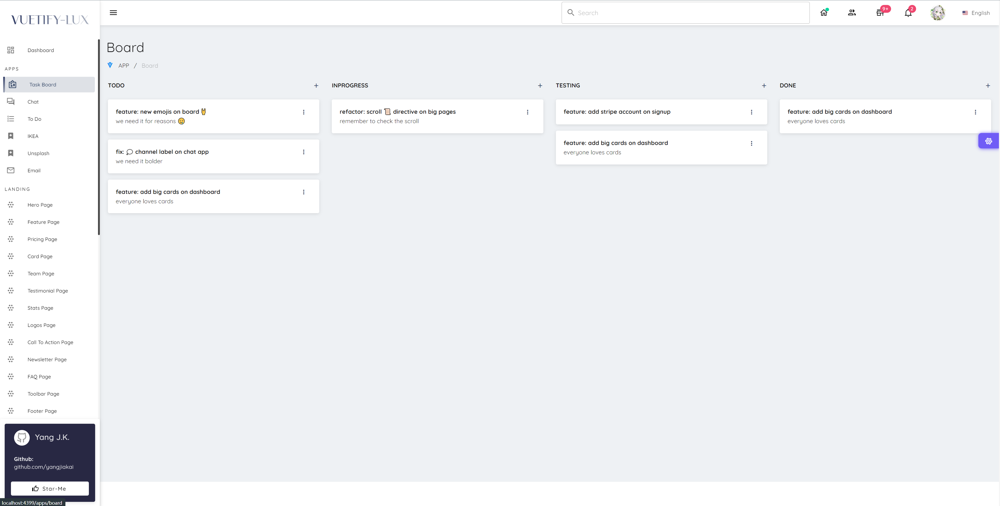
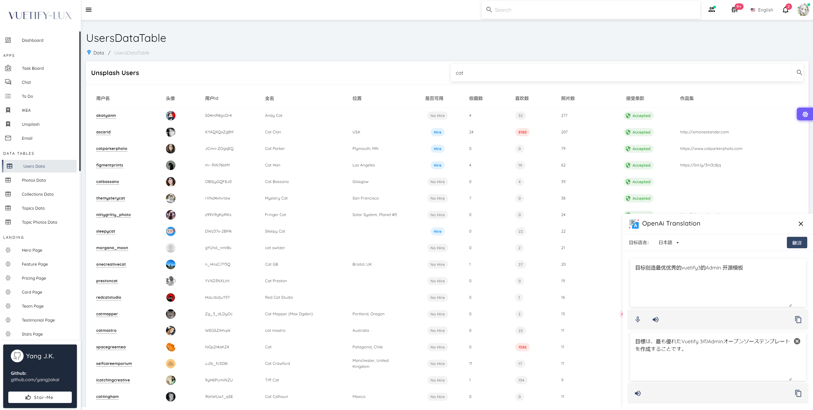
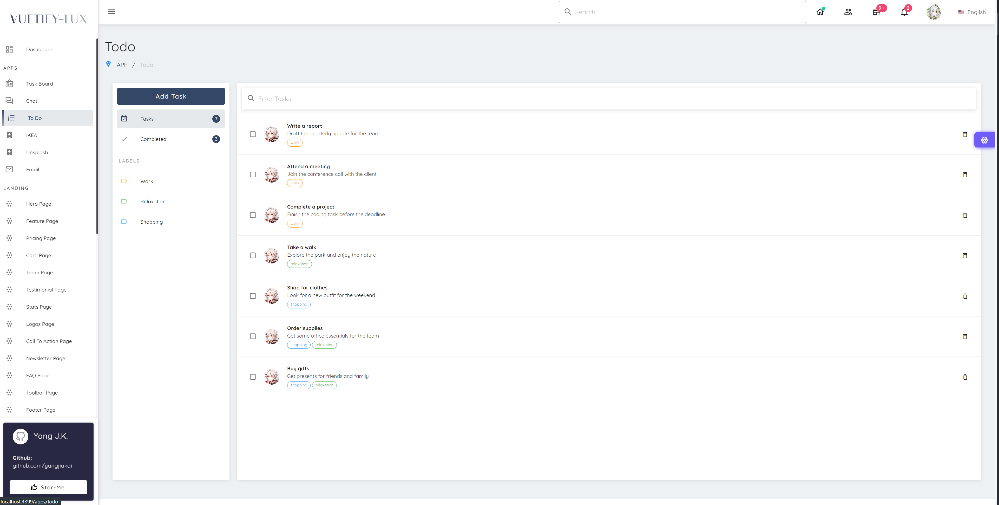
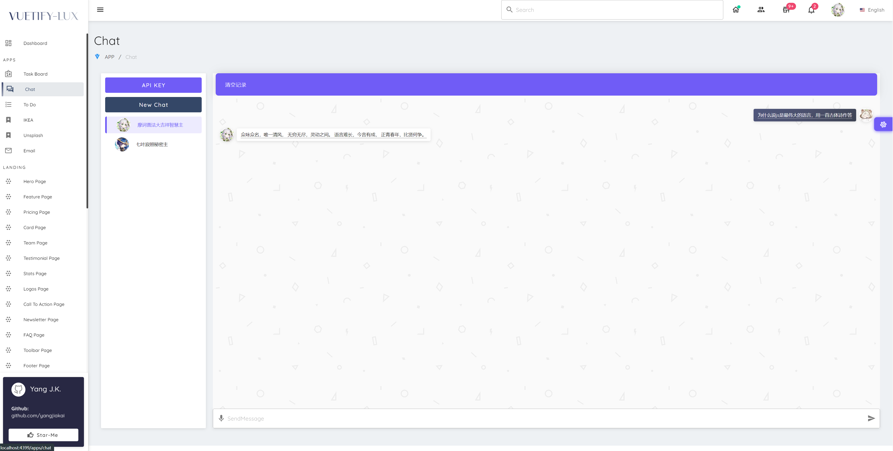
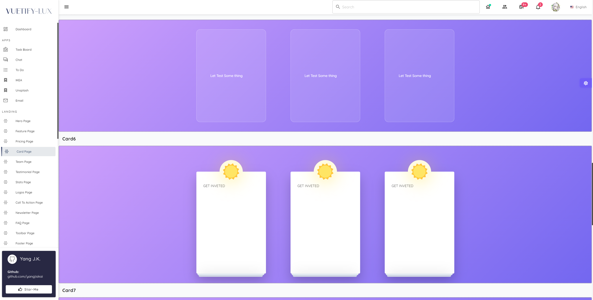
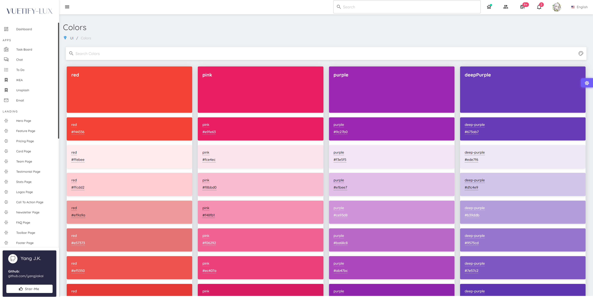
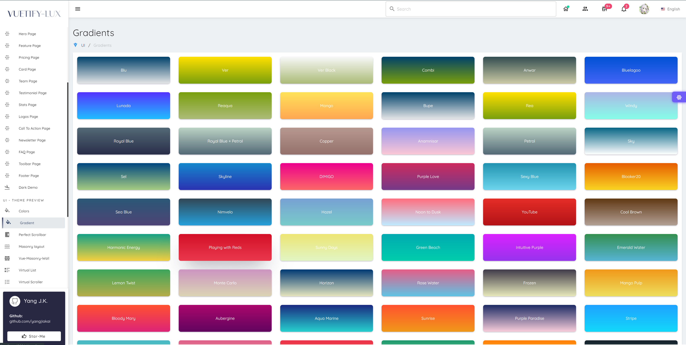
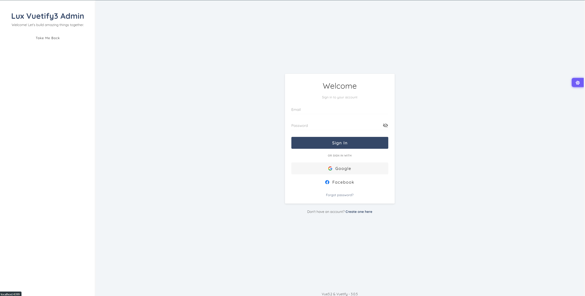
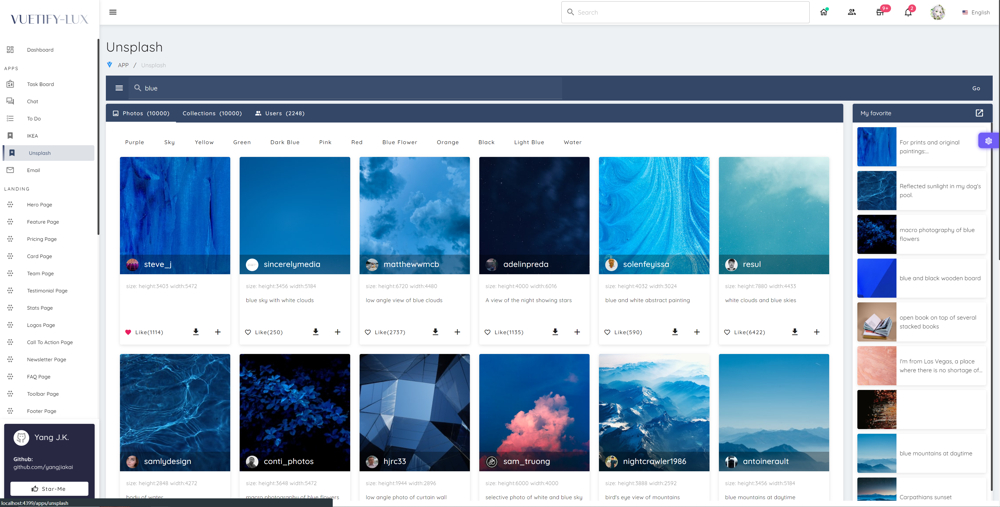
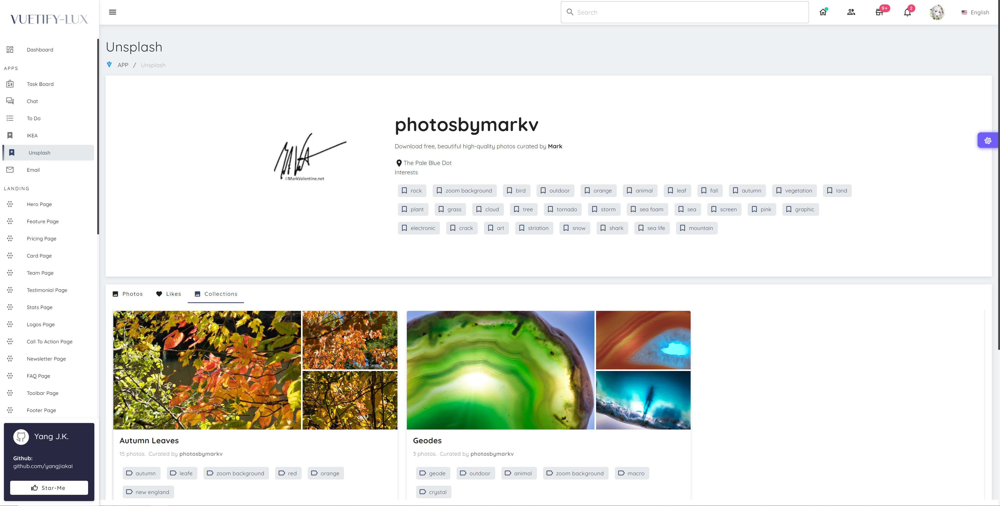

<br>

## 📦Pre-packed

### 🏷️ UI Frameworks

- [Vuetify3](https://vuetifyjs.com/) - Vuetify is a no design skills required UI Framework with beautifully handcrafted Vue Components.

### 🏷️ Icons

- [Iconify](https://iconify.design) - use icons from any icon sets [🔍Icônes](https://icones.netlify.app/)

### 🏷️ Plugins

- [Vue Router 5](https://router.vuejs.org/)
- [VueUse](https://github.com/antfu/vueuse) - collection of useful composition APIs
- [VuedDaggable](https://github.com/SortableJS/Vue.Draggable) - allowing drag-and-drop and synchronization with view model array.
- [Vue-Masonry-Wall](https://github.com/DerYeger/yeger/tree/main/packages/vue-masonry-wall) - Responsive masonry layout with SSR support and zero dependencies for Vue 3.
- [Vue-Virtual-Scroller](https://github.com/Akryum/vue-virtual-scroller) - Blazing fast scrolling of any amount of data

## 👻Try it now!

> Requires Node.js 20.19+ (24 recommended).

```
git clone https://github.com/yangjiakai/lux-ui.git

cd lux-ui

yarn install

yarn dev
```

## 👻Docker it!

1. Build the development environment image:

   ```
   docker-compose build dev
   ```

2. Start the development environment:

   ```
   docker-compose up dev
   ```

3. Build the production environment image:

   ```
   docker-compose build app
   ```

4. Start the production environment:
   ```
   docker-compose up app
   ```


### 🔑 Set ApiKey

Copy `.env.template` to `.env` and fill in `VITE_UNSPLASH_ACCESS_KEY`, `VITE_GITHUB_CLIENT_ID`, `VITE_TTS_KEY` and `VITE_TTS_REGION` with your own keys. `VITE_GA_ID` (Google Analytics) is optional.

The OpenAI API key is entered in the app itself and stored in the browser.

> Every `VITE_*` value is embedded in the built JavaScript, so only use keys that are safe to expose.

> openai apikey： https://platform.openai.com/account/api-keys

> unsplash apikey： https://unsplash.com/oauth/applications

> github apikey： https://github.com/settings/tokens

> azure textToSpeech : https://speech.microsoft.com/
