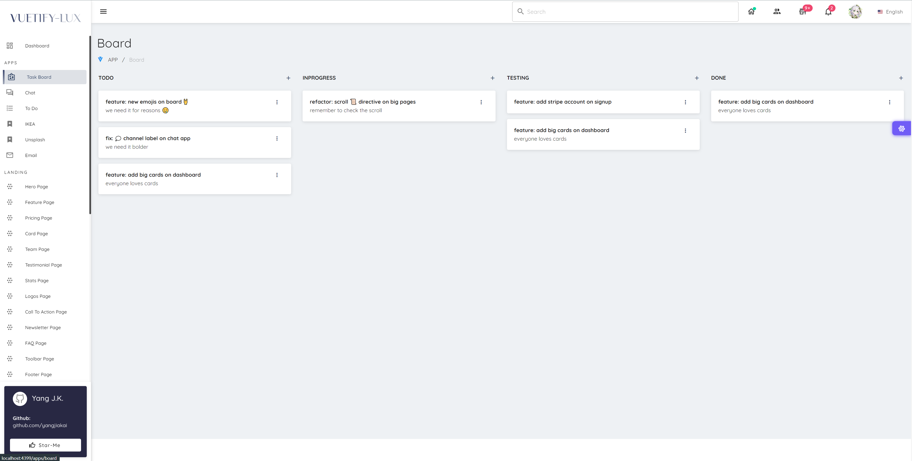
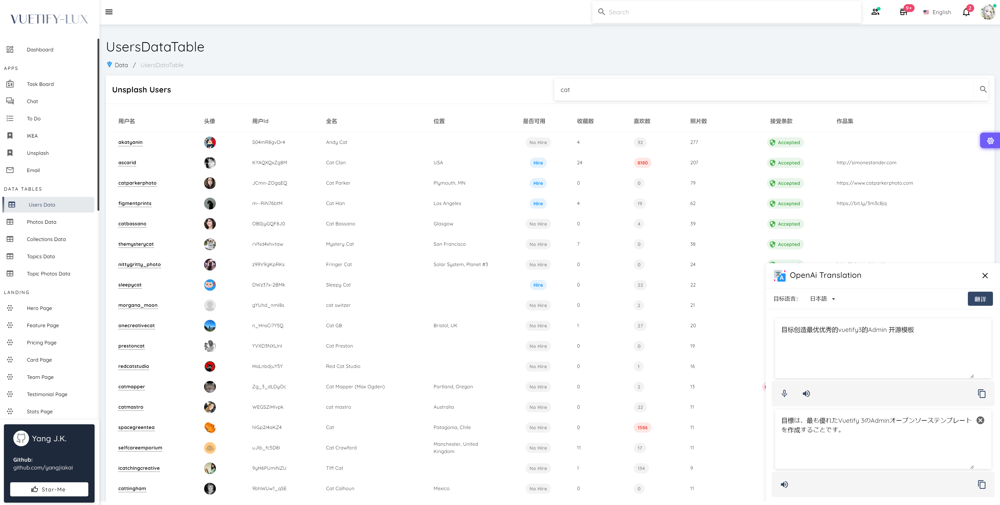
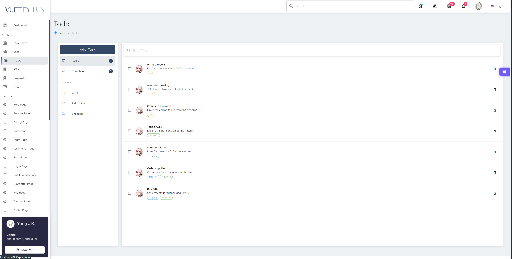
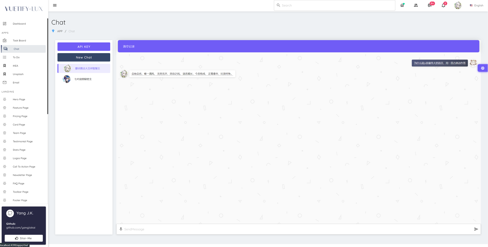
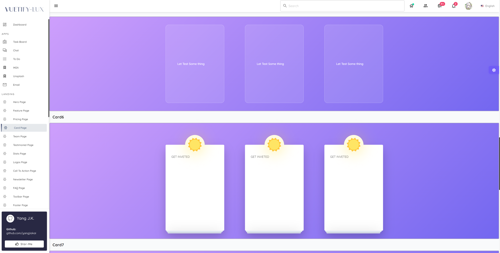
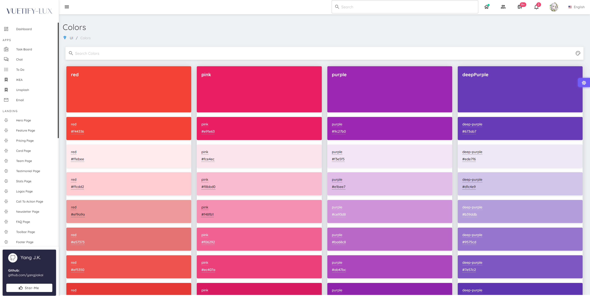
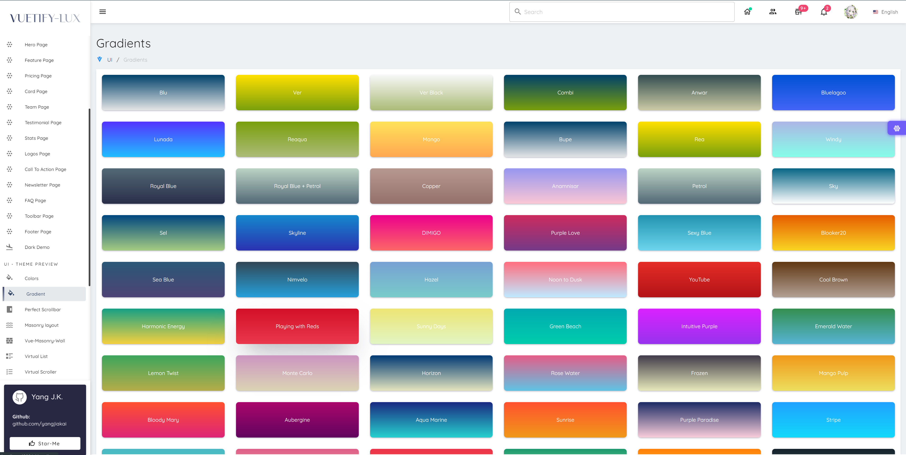
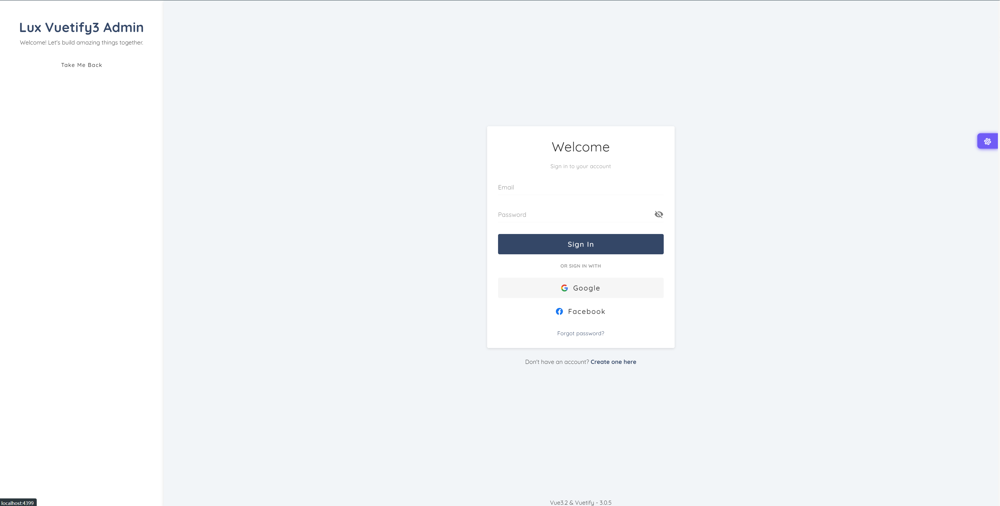
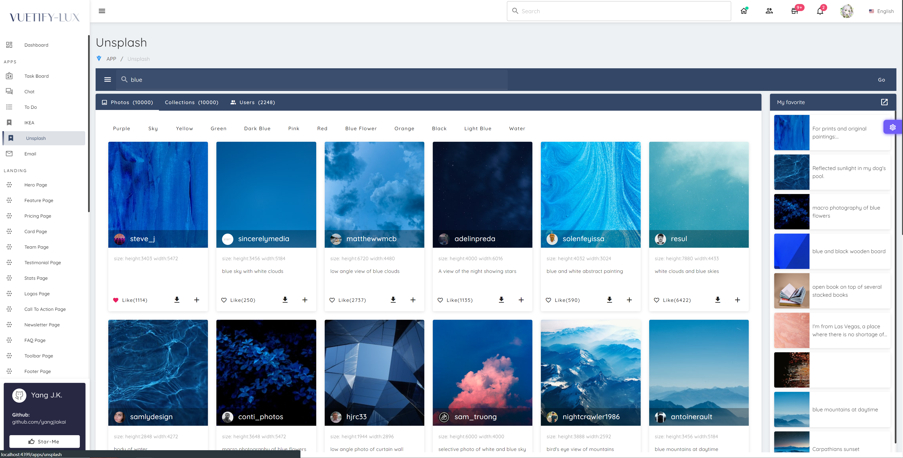
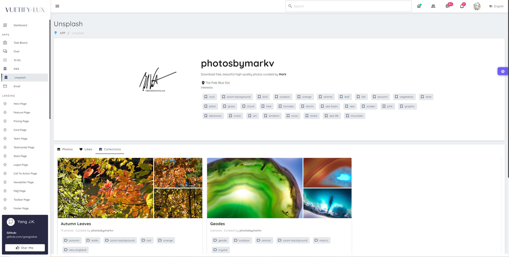

<br><br>

<p align='center' >
  
</p>
<br><br>

<p align="center">
  <a href="https://vuejs.org/">
    
  </a>
  <a href="https://vuetifyjs.com/">
    
  </a>
    <a href="https://vitejs.dev/">
    
  </a>
  
  <a href="https://github.com/yangjiakai/lux-ui/blob/main/LICENSE">
    
  </a>
</p>

<h4 align='center'>
<a href="https://lux.vuetify3.com/">在线 Demo</a>
</h4>

<br>

<p align='center'>
<a href="./README.md">English</a> | <b>简体中文</b> | <a href="./README.jp.md">日本語</a>
</p>

> **维护模式**：本项目会持续跟进 Vue / Vuetify 的新版本（现已升级到 **Vuetify 4**），但不再计划新增功能。欢迎继续提交 Issue 和 PR。

## 📖 序文

> 目标创造最优秀的 Vuetify Admin 开源模板

在 Vuetify 精美的主题基础上，我们构建了一个清晰且高效的项目逻辑架构，整合了最新的技术框架。本项目旨在实现各种常见的技术需求和功能，同时融合了 AI 助手，以提供更智能化的体验。此外，我们确保所有页面在多种设备上均能自适应展示，实现优雅的跨平台兼容性。

## 📖 其他版本

### SPA Version

SPA 完整版: [lux-vuetify3](https://github.com/yangjiakai/lux-nuxt3)

SPA 简化国际化模板 [lux-vuetify3-i18n](https://github.com/yangjiakai/vuetify3-lux-admin-template-i18n)

SPA 简化中文模板 [lux-vuetify3-zh](https://github.com/yangjiakai/vuetify3-lux-admin-template-zh)

### Nuxt3 Version

Nuxt3 完整版 [lux-nuxt3](https://github.com/yangjiakai/lux-nuxt3)

Nuxt3 简化版 [lux-nuxt3-template](https://github.com/yangjiakai/lux-nuxt3-template)

## 文档

- 📖 [中文版文档 1.0 ](https://www.craft.me/s/tAMVv4hUxZIH6G)

## 📚 特性

- 📖 [Vue 3.5](https://github.com/vuejs/core)
- 📖 [Vite 8](https://github.com/vitejs/vite)
- 📖 UI Framework [Vuetify 4](https://vuetifyjs.com/)
- 📖 TypeScript
- 📦 组件自动导入
- 🍍 通过 [Pinia](https://pinia.vuejs.org/)进行状态管理
- 📔 使用新的 `<script setup>` 语法
- 📚 使用任意的图标集 [Iconify](https://icon-sets.iconify.design/)
- ☁️ 零配置部署在 Netlify
- 📈 Echarts, ApexChart
- 🧭 Openai, Chatgpt 支持
- 🌍 vue-i18n 多语言支持
- 📚 virtual-scroller , vuedraggable , perfect-scrollbar
- 📝 富文本编辑器
- 📇 响应式多平台自适应

## 📈 项目活跃度


## 💬 联络我

- 邮箱 <a href="mailto:yjkbako@gmail.com">yjkbako@gmail.com</a>
- 推特 https://twitter.com/baibaixiang
- 微信 

## 💌 预览













<br>

## 📦Pre-packed

### 🏷️UI 框架

- [Vuetify3](https://vuetifyjs.com/) - Vuetify 是一个不要求设计能力的 Vue 界面组件框架，自带了许多自行设计实现的 Vue 组件。

### 🏷️Icons

- [Iconify](https://iconify.design) - 使用任意的图标集 [🔍Icônes](https://icones.netlify.app/)

## 目标功能

- [x] 明暗主题切换 -- 完成
- [x] 主题色切换 -- 完成
- [x] 中日英三语言切换-- 完成
- [x] 整合 ChatGpt-- 完成

## 目标页面

### 认证相关

- [x] 登录 -- 完成
- [x] 注册 -- 完成
- [x] 验证邮件 -- 完成
- [ ] 密码重置 -- 施工中

### 公共页面

- [x] 404 -- 完成
- [x] 500 -- 施工中
- [x] 系统维护 -- 施工中
- [x] 常见问题 -- 施工中

### UI 相关

- [x] 瀑布流布局 -- 完成
- [x] 大数据虚拟列表 -- 完成
- [ ] 骨架屏 -- 施工中

### 功能页面

- [x] 任务版(拖拽功能) -- 完成
- [x] 任务列表() -- 施工中

### 站点仿写

- [ ] ......

### 🏷️ 插件

- [Vue Router 5](https://router.vuejs.org/)
- [VueUse](https://github.com/antfu/vueuse) - 非常有用的组合式 API 合集
- [VuedDaggable](https://github.com/SortableJS/Vue.Draggable) - 允许进行与数组模型同步的拖拽放置操作
- [Vue-Masonry-Wall](https://github.com/DerYeger/yeger/tree/main/packages/vue-masonry-wall) - 是一种 Vue3 响应式,支持 SSR,且零依的的瀑布流布局方案
- [Vue-Virtual-Scroller](https://github.com/Akryum/vue-virtual-scroller) - 大数据快速虚拟滚动插件

## 👻 现在可以试试!

> 需要 Node.js 20.19 以上（推荐 24）。

```
git clone https://github.com/yangjiakai/lux-ui.git

cd lux-ui

yarn install

yarn dev
```

## 👻Docker it!

1. 开发环境构建镜像：

   ```
   docker-compose build dev
   ```

2. 启动开发环境：

   ```
   docker-compose up dev
   ```

3. 生产环境构建镜像：

   ```
   docker-compose build app
   ```

4. 启动生产环境：
   ```
   docker-compose up app
   ```

### 🔑 配置 ApiKey

把根目录下的 `.env.template` 复制为 `.env`，将 `VITE_UNSPLASH_ACCESS_KEY`、`VITE_GITHUB_CLIENT_ID`、`VITE_TTS_KEY`、`VITE_TTS_REGION` 替换成你自己的 key。`VITE_GA_ID`（Google Analytics）可选。

OpenAI 的 API key 在应用内输入，保存在浏览器中。

> 所有 `VITE_*` 变量都会被打包进前端代码，请只填写可以公开的 key。

> openai apikey： https://platform.openai.com/account/api-keys

> unsplash apikey： https://unsplash.com/oauth/applications

> github apikey： https://github.com/settings/tokens

> azure textToSpeech : https://speech.microsoft.com/
